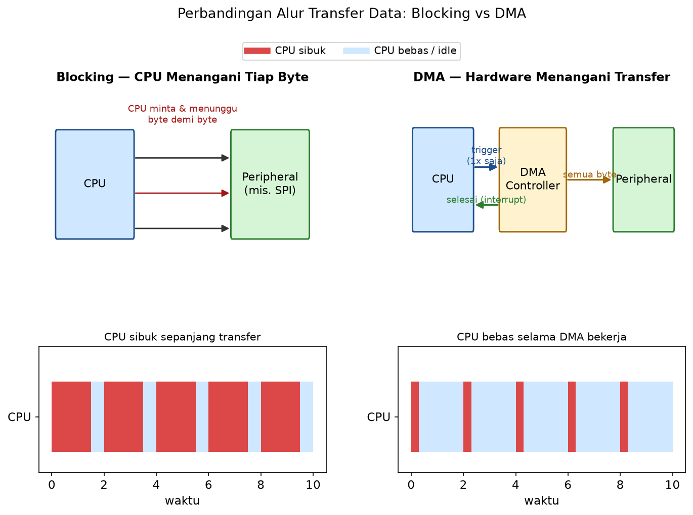
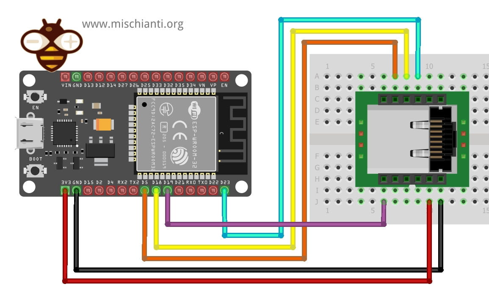
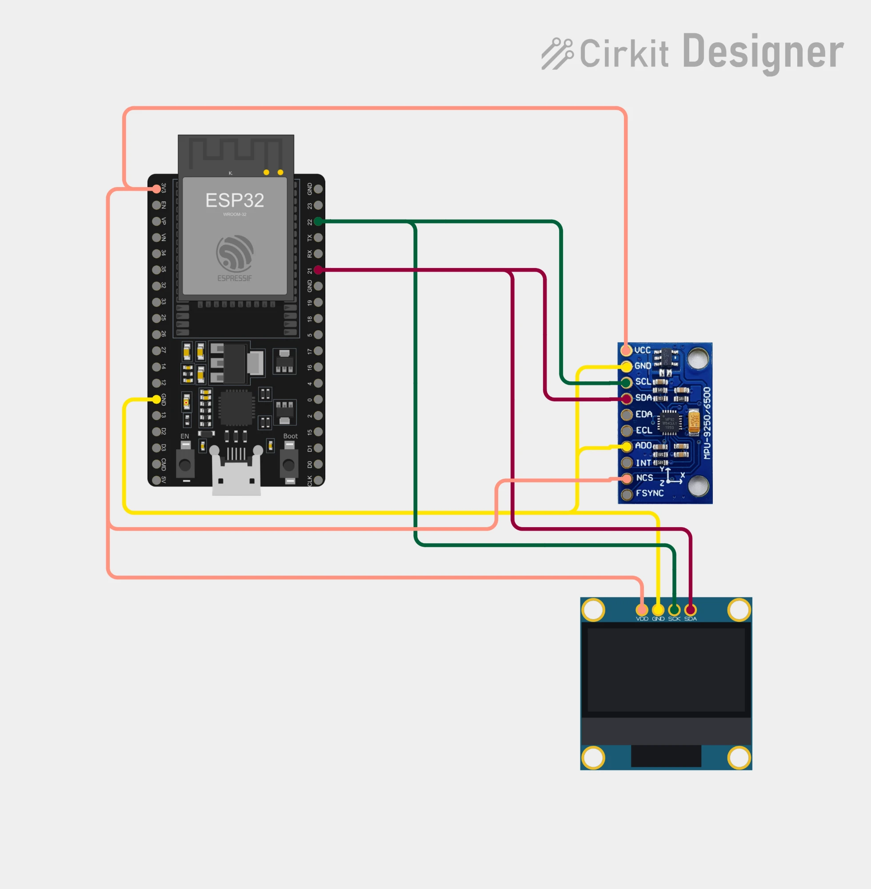
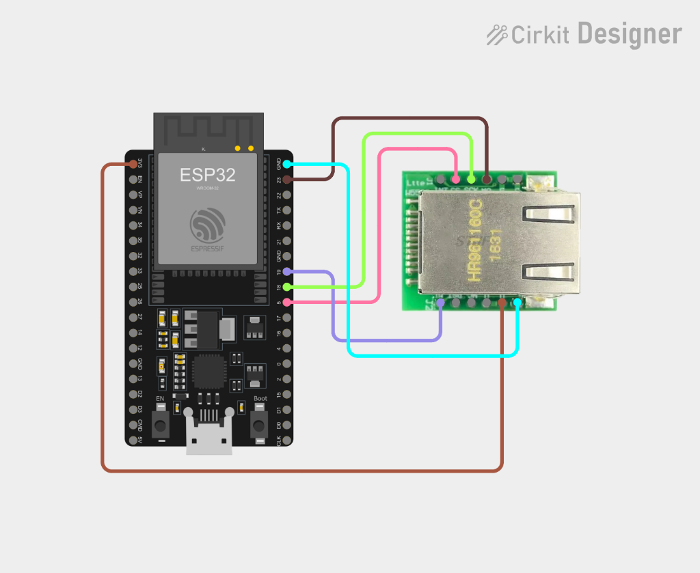

# MODUL 3
# KOMUNIKASI SERIAL & INTERFACING MODUL (UART/I2C/SPI/DMA)

**Mata Kuliah:** Praktikum Mikrokontroler & Embedded System
**Alokasi Waktu:** 5 x Percobaan (@ 100–150 menit)
**Platform:** ESP32 (Framework Arduino)
**IDE:** VSCode + PlatformIO

> **Catatan:** Modul ini melanjutkan penggunaan ESP32 dengan framework Arduino seperti pada Modul 1–2. Langkah instalasi VSCode, PlatformIO, dan driver USB-to-Serial tidak diulang di sini — lihat **[setup_vscode_platformio.md](setup_vscode_platformio.md)**. Percobaan 1 (UART) membutuhkan **dua board ESP32** yang saling berkomunikasi.

---

## Daftar Isi
- [MODUL 3](#modul-3)
- [KOMUNIKASI SERIAL \& INTERFACING MODUL (UART/I2C/SPI/DMA)](#komunikasi-serial--interfacing-modul-uarti2cspidma)
  - [Daftar Isi](#daftar-isi)
  - [A. Capaian Pembelajaran](#a-capaian-pembelajaran)
  - [B. Alat dan Bahan](#b-alat-dan-bahan)
  - [C. Dasar Teori](#c-dasar-teori)
    - [C.1 UART (Universal Asynchronous Receiver-Transmitter)](#c1-uart-universal-asynchronous-receiver-transmitter)
    - [C.2 I2C (Inter-Integrated Circuit)](#c2-i2c-inter-integrated-circuit)
    - [C.3 SPI (Serial Peripheral Interface)](#c3-spi-serial-peripheral-interface)
    - [C.4 DMA (Direct Memory Access)](#c4-dma-direct-memory-access)
    - [C.5 SPI ke Ethernet (W5500)](#c5-spi-ke-ethernet-w5500)
  - [D. Persiapan Sebelum Praktikum](#d-persiapan-sebelum-praktikum)
  - [E. Kegiatan Praktikum](#e-kegiatan-praktikum)
    - [PERCOBAAN 1 — Komunikasi UART Antar ESP32](#percobaan-1--komunikasi-uart-antar-esp32)
    - [PERCOBAAN 2 — Interfacing Multi-Device I2C: OLED + MPU6500](#percobaan-2--interfacing-multi-device-i2c-oled--mpu6500)
    - [PERCOBAAN 3 — Interfacing SPI: IMU MPU6500 (Pembacaan Register SPI Manual)](#percobaan-3--interfacing-spi-imu-mpu6500-pembacaan-register-spi-manual)
    - [PERCOBAAN 4 — DMA: Pembacaan IMU MPU6500 via SPI dengan DMA](#percobaan-4--dma-pembacaan-imu-mpu6500-via-spi-dengan-dma)
    - [PERCOBAAN 5 — Komunikasi Ethernet via SPI (W5500)](#percobaan-5--komunikasi-ethernet-via-spi-w5500)
  - [F. Tugas Modul](#f-tugas-modul)
  - [G. Referensi](#g-referensi)

---

## A. Capaian Pembelajaran

Setelah menyelesaikan Modul 3, praktikan mampu:
1. Menjelaskan prinsip kerja protokol komunikasi UART, I2C, dan SPI
2. Mengimplementasikan komunikasi UART antar dua board ESP32
3. Mengimplementasikan interfacing lebih dari satu modul I2C sekaligus pada satu bus (OLED display + IMU MPU6500)
4. Mengimplementasikan interfacing modul eksternal melalui SPI (IMU MPU6500)
5. Menjelaskan konsep DMA dan mengimplementasikan pembacaan data IMU melalui SPI dengan DMA diaktifkan, serta membandingkannya dengan metode pembacaan blocking biasa
6. Mengimplementasikan komunikasi Ethernet melalui SPI menggunakan modul W5500, serta memverifikasi konektivitas jaringan dengan PC

---

## B. Alat dan Bahan

| No | Nama Komponen | Spesifikasi | Jumlah |
|---|---|---|---|
| 1 | Board ESP32 DevKit | ESP32 DevKit v1 | 2 |
| 2 | Kabel USB Micro/USB-C | untuk tiap ESP32 ke PC | 2 |
| 3 | Breadboard | 830 titik | 1 |
| 4 | Kabel jumper male-male / male-female | — | secukupnya |
| 5 | Modul OLED display | SSD1306 atau SH1106, 128x64, I2C (chip ditentukan di kode, lihat Percobaan 2) | 1 |
| 6 | Modul IMU MPU6500 | breakout dual-interface I2C/SPI — **dipakai ulang**: I2C pada Percobaan 2, SPI pada Percobaan 3–4 (rewiring CS diperlukan saat berpindah) | 1 |
| 7 | Resistor pull-up | 4.7kΩ (opsional, jika bus I2C tidak stabil) | 2 |
| 8 | Modul Ethernet W5500 | breakout dengan interface SPI + port RJ45 | 1 |
| 9 | Kabel RJ45 (patch cord) | untuk menghubungkan W5500 ke switch/router yang sama dengan PC | 1 |
| 10 | Laptop/PC | VSCode + PlatformIO terinstal, terhubung ke jaringan yang sama dengan W5500 | 1 |

---

## C. Dasar Teori

### C.1 UART (Universal Asynchronous Receiver-Transmitter)
UART adalah protokol komunikasi serial **asinkron** — tidak menggunakan sinyal clock bersama, sehingga kedua perangkat harus disepakati terlebih dahulu **baud rate**-nya (kecepatan transmisi, mis. 115200 bps) agar dapat saling memahami data. Komunikasi UART menggunakan dua jalur: **TX** (transmit) dan **RX** (receive), dengan aturan pin TX satu perangkat disambungkan ke pin RX perangkat lainnya (silang). ESP32 memiliki beberapa UART hardware; selain UART0 (digunakan untuk Serial Monitor/upload program), tersedia UART1 dan UART2 yang dapat dikonfigurasi bebas pada pin GPIO yang diinginkan menggunakan `HardwareSerial`.


### C.2 I2C (Inter-Integrated Circuit)
I2C adalah protokol komunikasi serial **sinkron** yang hanya membutuhkan dua jalur: **SDA** (Serial Data) dan **SCL** (Serial Clock), memungkinkan banyak perangkat terhubung pada bus yang sama. Setiap perangkat (**slave**) memiliki alamat unik (7-bit), sedangkan satu perangkat bertindak sebagai **master** yang mengatur clock dan menginisiasi komunikasi. Pada ESP32, pin default I2C adalah **SDA = GPIO 21** dan **SCL = GPIO 22**, diakses melalui library `Wire`.

Karena setiap perangkat I2C dibedakan melalui **alamat**, bukan jalur fisik terpisah seperti SPI, **lebih dari satu perangkat dapat berbagi SDA/SCL yang sama** selama alamatnya berbeda. Dua contoh perangkat I2C yang digunakan pada modul ini:
- **OLED display (SSD1306 atau SH1106):** alamat tetap `0x3C`, dikendalikan melalui perintah-perintah yang telah diabstraksi oleh library (mis. U8g2), sehingga praktikan tidak perlu menulis manual setiap byte perintah ke controller display
- **IMU MPU6500:** alamat default `0x68` (dapat berubah menjadi `0x69` tergantung kondisi pin `AD0`), diakses melalui pembacaan/penulisan register secara langsung (mis. `PWR_MGMT_1` untuk membangunkan sensor, `ACCEL_XOUT_H` untuk data akselerometer)

> **Catatan:** MPU6500 mendukung **dua antarmuka sekaligus** dalam satu chip — I2C maupun SPI — tergantung kondisi pin **CS/NCS**. Jika CS ditarik tetap ke VCC (3.3V), modul beroperasi dalam mode I2C (dipakai pada Percobaan ini); jika CS di-toggle oleh master, modul beralih ke mode SPI (dipakai pada Percobaan 3–4). Artinya, **modul IMU yang sama** dapat dipakai ulang di kedua Percobaan tersebut, cukup dengan mengubah wiring pin CS — mendemonstrasikan bahwa satu sensor dapat diakses melalui protokol fisik yang berbeda.


### C.3 SPI (Serial Peripheral Interface)
SPI adalah protokol komunikasi serial sinkron **full-duplex** (dapat mengirim dan menerima data secara bersamaan), menggunakan empat jalur: **MOSI** (Master Out Slave In), **MISO** (Master In Slave Out), **SCK** (Serial Clock), dan **CS/SS** (Chip Select). Berbeda dengan I2C yang menggunakan pengalamatan, SPI memilih perangkat tujuan melalui jalur CS terpisah untuk masing-masing slave — sehingga umumnya lebih cepat namun membutuhkan lebih banyak jalur pin dibanding I2C. Banyak sensor presisi tinggi seperti IMU (Inertial Measurement Unit) MPU6500 menyediakan antarmuka SPI, diakses melalui pembacaan/penulisan **register** — setiap register memiliki alamat 8-bit, dengan bit paling signifikan (MSB) menandai operasi baca (`1`) atau tulis (`0`).


*Gambar 3: Diagram blok koneksi SPI Controller (Master) dan Peripheral (Slave). SDO/SDI pada gambar setara dengan MOSI/MISO — SDO Controller = MOSI, SDI Controller = MISO.*

### C.4 DMA (Direct Memory Access)
DMA adalah mekanisme perangkat keras yang memungkinkan transfer data antara peripheral dan memori **tanpa melibatkan CPU secara langsung** pada setiap byte data. Tanpa DMA, pembacaan/pengiriman data mengharuskan CPU secara aktif menangani transfer tiap byte (*blocking*), yang menghabiskan waktu eksekusi CPU. Pada ESP32, DMA untuk SPI diaktifkan langsung saat inisialisasi bus SPI (parameter *DMA channel* pada `spi_bus_initialize()`), sehingga transfer data berukuran besar — misalnya membaca beberapa register sekaligus pada IMU dalam satu transaksi — dapat dilakukan hardware secara mandiri, dan CPU hanya perlu menunggu transaksi selesai alih-alih menangani tiap byte secara manual.



*Gambar 4: Diagram blok perbandingan alur transfer data blocking (CPU menangani tiap byte) vs DMA (CPU hanya memicu lalu menunggu, hardware DMA menangani transfer)*

### C.5 SPI ke Ethernet (W5500)
Selain untuk sensor, SPI juga umum dipakai untuk menghubungkan mikrokontroler ke peripheral **komunikasi jaringan**. **W5500** adalah chip Ethernet "hardwired" — seluruh stack TCP/IP (ARP, IP, TCP, UDP, termasuk ICMP) diimplementasikan langsung di dalam hardware chip, sehingga mikrokontroler tidak perlu menjalankan software stack TCP/IP sendiri (berbeda dengan chip seperti ENC28J60 yang hanya menyediakan lapisan MAC/PHY, sehingga memerlukan stack software seperti lwIP). Mikrokontroler berkomunikasi dengan W5500 melalui SPI menggunakan protokol register/socket milik W5500, yang pada framework Arduino sudah diabstraksi penuh oleh library `Ethernet`.

Karena ARP dan **ICMP Echo (ping)** ditangani otomatis oleh hardware chip, cukup dengan `Ethernet.begin()` menggunakan IP yang valid, W5500 akan langsung dapat di-*ping* dari perangkat lain di jaringan yang sama — tanpa perlu menulis kode tambahan apa pun untuk merespons ping.



*Gambar 5: Diagram wiring SPI antara ESP32 dan modul W5500, beserta koneksi RJ45 ke jaringan lokal yang sama dengan PC*

---

## D. Persiapan Sebelum Praktikum

1. Pastikan PlatformIO sudah terinstal (lihat **[setup_vscode_platformio.md](setup_vscode_platformio.md)**)
2. Siapkan **dua board ESP32** untuk Percobaan 1 — satu berperan sebagai pengirim (Transmitter), satu lagi sebagai penerima (Receiver)
3. Library `Wire` (I2C) dan `SPI` sudah termasuk dalam Arduino-ESP32 core, tidak perlu instalasi tambahan
4. Untuk interfacing OLED pada Percobaan 2, tambahkan library **U8g2** melalui PlatformIO Library Manager atau pada `platformio.ini`:
   ```ini
   lib_deps = olikraus/U8g2@^2.35.0
   ```
5. Interfacing MPU6500 pada Percobaan 3 dan 4 dilakukan dengan pembacaan register SPI secara manual (tanpa library eksternal), agar praktikan memahami langsung protokol SPI yang mendasarinya
6. Untuk komunikasi Ethernet pada Percobaan 5, tambahkan library **Ethernet** melalui PlatformIO Library Manager atau pada `platformio.ini`:
   ```ini
   lib_deps = arduino-libraries/Ethernet@^2.0.2
   ```
7. Buat project baru untuk Modul 3:
   - Name: `modul3-komunikasi-serial`
   - Board: **"Espressif ESP32 Dev Module"**
   - Framework: **Arduino**
8. Pastikan `platformio.ini` berisi:
   ```ini
   [env:esp32dev]
   platform = espressif32
   board = esp32dev
   framework = arduino
   ```
9. Karena Percobaan 1 membutuhkan dua sketch program berbeda (pengirim & penerima) yang berjalan di board terpisah, buat **dua project PlatformIO terpisah**, atau gunakan dua folder `src` berbeda yang di-build bergantian ke masing-masing board

---

## E. Kegiatan Praktikum

### PERCOBAAN 1 — Komunikasi UART Antar ESP32

**Tujuan:**
Mahasiswa mampu mengimplementasikan komunikasi UART antara dua board ESP32 menggunakan UART hardware kedua (UART2).

**Skema Rangkaian:**

| Board | Pin | Terhubung ke |
|---|---|---|
| ESP32 Transmitter — TX2 | GPIO 17 | RX2 (GPIO 16) pada ESP32 Receiver |
| ESP32 Transmitter — RX2 | GPIO 16 | TX2 (GPIO 17) pada ESP32 Receiver |
| ESP32 Transmitter — GND | GND | GND pada ESP32 Receiver |

> Kedua board tetap terhubung ke PC melalui USB masing-masing (untuk power dan Serial Monitor UART0), sehingga total terdapat 3 kabel yang menghubungkan kedua board: TX↔RX (silang) dan GND bersama.

**`platformio.ini`** (sama untuk project Transmitter maupun Receiver):
```ini
[env:esp32dev]
platform = espressif32
board = esp32dev
framework = arduino
```

**Langkah Kerja:**
1. Buat dua project terpisah: satu untuk **Transmitter** (pengirim) dan satu untuk **Receiver** (penerima)
2. Tulis kode Transmitter, lalu upload ke board pertama
3. Tulis kode Receiver, lalu upload ke board kedua
4. Sambungkan TX2 board pertama ke RX2 board kedua dan sebaliknya (disilang), lalu sambungkan GND kedua board
5. Buka Serial Monitor milik Receiver, lalu lihat data yang masuk setiap detik
6. Ubah kecepatan komunikasi (baud rate) pada `UART.begin()` di **Receiver saja**, misalnya menjadi 9600. Klik Build dan Upload ulang, lalu lihat apa yang terjadi pada datanya
7. Analisis mengapa kedua sisi UART harus memakai baud rate yang sama, padahal tidak ada kabel clock bersama seperti I2C dan SPI

**Kode Program (ESP32 Transmitter):**
```cpp
#include <Arduino.h>

HardwareSerial UART(2);

void setup() {
    Serial.begin(115200);
    UART.begin(115200, SERIAL_8N1, 16, 17); // RX, TX

    Serial.println("ESP32 Transmitter");
}

void loop() {
    UART.println("Hello ESP32!");
    Serial.println("Data terkirim");

    delay(1000);
}
```

**Kode Program (ESP32 Receiver):**
```cpp
#include <Arduino.h>

HardwareSerial UART(2);

void setup() {
    Serial.begin(115200);
    UART.begin(115200, SERIAL_8N1, 16, 17); // RX, TX

    Serial.println("ESP32 Receiver");
}

void loop() {
    if (UART.available()) {
        String data = UART.readStringUntil('\n');

        Serial.print("Data diterima: ");
        Serial.println(data);
    }
}
```

**Penjelasan Kode:**
| Bagian | Penjelasan |
|---|---|
| `HardwareSerial UART(2)` | Membuat objek UART hardware kedua (UART2) pada ESP32, terpisah dari `Serial` (UART0) yang digunakan untuk Serial Monitor |
| `UART.begin(115200, SERIAL_8N1, 16, 17)` | Menginisialisasi UART2 dengan baud rate 115200, format data 8N1 (8 data bit, no parity, 1 stop bit), pin RX=16 dan TX=17 |
| `UART.println(...)` | Mengirim data melalui UART2 ke board lain |
| `UART.available()` | Memeriksa apakah ada data masuk yang siap dibaca pada buffer UART2 |
| `UART.readStringUntil('\n')` | Membaca data hingga menemukan karakter newline, sesuai data yang dikirim menggunakan `println()` |

---

### PERCOBAAN 2 — Interfacing Multi-Device I2C: OLED + MPU6500

**Tujuan:**
Mahasiswa mampu mengimplementasikan interfacing lebih dari satu modul I2C nyata sekaligus pada satu bus (OLED display dan IMU MPU6500 dalam mode I2C).

**Skema Rangkaian:**

| Komponen | Pin ESP32 | Keterangan |
|---|---|---|
| OLED (SSD1306/SH1106) — SDA | GPIO 21 | Bus I2C default — **dibagi bersama** dengan MPU6500 |
| OLED (SSD1306/SH1106) — SCL | GPIO 22 | Bus I2C default — **dibagi bersama** dengan MPU6500 |
| OLED (SSD1306/SH1106) — VCC/GND | 3.3V, GND | Periksa datasheet modul (umumnya toleran 3.3–5V) |
| MPU6500 — SDA (pin SDI pada mode SPI) | GPIO 21 | Bus I2C default — pin **sama persis** dengan OLED |
| MPU6500 — SCL (pin SCLK pada mode SPI) | GPIO 22 | Bus I2C default — pin **sama persis** dengan OLED |
| MPU6500 — CS/NCS | **3.3V (ditarik tetap, bukan di-toggle)** | **Wajib** — inilah yang memilih mode I2C, berbeda dari Percobaan 3–4 di mana CS di-toggle sebagai chip select SPI |
| MPU6500 — VCC/GND | 3.3V, GND | MPU6500 umumnya hanya toleran 3.3V |

> Kedua perangkat disambungkan ke **pin SDA/SCL yang sama** — ini adalah inti dari percobaan ini: membuktikan bahwa I2C dapat melayani banyak perangkat pada satu bus fisik, selama alamatnya berbeda (OLED = `0x3C`, MPU6500 = `0x68`). Perhatikan juga bahwa modul MPU6500 ini adalah **modul yang sama** yang nanti dipakai ulang pada Percobaan 3–4 melalui SPI — cukup pindahkan wiring CS dari "ditarik ke 3.3V" menjadi "terhubung ke GPIO CS ESP32" saat berpindah Percobaan.



*Gambar 6: Wiring OLED dan MPU6500 berbagi bus I2C (SDA/SCL) yang sama pada ESP32*

**`platformio.ini`:**
```ini
[env:esp32dev]
platform = espressif32
board = esp32dev
framework = arduino
lib_deps = olikraus/U8g2@^2.35.0
```
> MPU6500 diakses melalui pembacaan/penulisan register `Wire` secara manual, sehingga tidak memerlukan library tambahan selain U8g2 untuk OLED.

**Langkah Kerja:**
1. Pasang OLED dan MPU6500 pada dua kabel data yang sama (SDA dan SCL dipakai bersama). Pin CS MPU6500 **disambungkan ke 3.3V** supaya sensor bekerja dengan cara I2C
2. Salin kode dari file [`Kode_Pendukung/i2c_scanner.cpp`](Kode_Pendukung/i2c_scanner.cpp) ke `src/main.cpp`, klik **Build** dan **Upload**, lalu buka Serial Monitor. Pastikan **kedua alamat** muncul: `0x3C` (OLED) dan `0x68` (MPU6500). Jika tidak muncul, periksa kabel SDA, SCL, VCC, dan GND
3. Tulis kode di bawah pada `src/main.cpp`. Di bagian `PILIH CHIP OLED`, biarkan **satu** baris `#define` aktif sesuai chip OLED Anda (`OLED_SSD1306` atau `OLED_SH1106`), dan beri `//` pada baris yang lain
4. Klik **Build** dan **Upload**. OLED akan menampilkan "MPU6500 Ready", lalu nilai akselerometer dan giroskop. Jika layar kosong atau tampilannya bergeser, kemungkinan pilihan chip salah, jadi ganti pilihan di langkah 3 lalu upload ulang
5. Miringkan dan goyangkan sensor, lalu lihat nilainya berubah di OLED dan Serial Monitor. Ini membuktikan kedua perangkat bisa dipakai bergantian tanpa saling mengganggu
6. Cabut OLED sementara. MPU6500 seharusnya tetap terbaca di Serial Monitor
7. Analisis mengapa mencabut satu perangkat tidak mengganggu perangkat lain. Kaitkan dengan alamat masing-masing (`0x3C` dan `0x68`)

**Kode Program (OLED + MPU6500 pada Satu Bus I2C):**
```cpp
#include <Arduino.h>
#include <Wire.h>
#include <U8g2lib.h>

#define SDA_PIN 21
#define SCL_PIN 22

#define MPU_ADDR 0x68
#define OLED_ADDR 0x3C

// ==================== PILIH CHIP OLED ====================
// Aktifkan SATU baris saja, sesuai chip pada modul OLED Anda
#define OLED_SSD1306
// #define OLED_SH1106

#if defined(OLED_SSD1306)
U8G2_SSD1306_128X64_NONAME_F_HW_I2C oled(
    U8G2_R0,
    U8X8_PIN_NONE
);
#elif defined(OLED_SH1106)
U8G2_SH1106_128X64_NONAME_F_HW_I2C oled(
    U8G2_R0,
    U8X8_PIN_NONE
);
#endif

// Menulis satu register MPU6500
bool writeRegister(uint8_t reg, uint8_t value) {
    Wire.beginTransmission(MPU_ADDR);
    Wire.write(reg);
    Wire.write(value);
    return Wire.endTransmission() == 0;
}

// Membaca beberapa register MPU6500
bool readRegisters(uint8_t reg, uint8_t *data, uint8_t len) {
    Wire.beginTransmission(MPU_ADDR);
    Wire.write(reg);

    if (Wire.endTransmission(false) != 0) {
        return false;
    }

    uint8_t received = Wire.requestFrom(
        (uint8_t)MPU_ADDR,
        len,
        (uint8_t)true
    );

    if (received != len) {
        while (Wire.available()) Wire.read();
        return false;
    }

    for (uint8_t i = 0; i < len; i++) {
        data[i] = Wire.read();
    }

    return true;
}

// Menggabungkan byte high dan low menjadi signed 16-bit
int16_t toInt16(uint8_t highByte, uint8_t lowByte) {
    return (int16_t)(((uint16_t)highByte << 8) | lowByte);
}

bool initMPU6500() {
    // Bangunkan sensor dari mode sleep
    if (!writeRegister(0x6B, 0x00)) return false;
    delay(100);

    // Gyroscope: +/- 250 derajat/detik
    if (!writeRegister(0x1B, 0x00)) return false;

    // Accelerometer: +/- 2g
    if (!writeRegister(0x1C, 0x00)) return false;

    // Aktifkan digital low-pass filter
    if (!writeRegister(0x1A, 0x03)) return false;

    return true;
}

void setup() {
    Serial.begin(115200);

    Wire.begin(SDA_PIN, SCL_PIN);
    Wire.setClock(100000);

    // Inisialisasi OLED
    oled.setI2CAddress(OLED_ADDR * 2);
    oled.begin();

    oled.setFont(u8g2_font_6x12_tr);
    oled.clearBuffer();
    oled.drawStr(0, 20, "MPU6500 + OLED");
    oled.drawStr(0, 40, "Initializing...");
    oled.sendBuffer();

    // Periksa komunikasi MPU6500
    uint8_t whoAmI = 0;

    if (!readRegisters(0x75, &whoAmI, 1)) {
        Serial.println("Gagal membaca MPU6500!");

        oled.clearBuffer();
        oled.drawStr(0, 25, "MPU I2C ERROR");
        oled.sendBuffer();

        while (true) delay(100);
    }

    Serial.printf("WHO_AM_I: 0x%02X\n", whoAmI);

    if (!initMPU6500()) {
        Serial.println("Inisialisasi MPU6500 gagal!");
        while (true) delay(100);
    }

    oled.clearBuffer();
    oled.drawStr(0, 25, "MPU6500 Ready");
    oled.sendBuffer();

    delay(500);
}

void loop() {
    uint8_t data[14];

    // Baca data akselerometer, suhu, dan giroskop
    if (!readRegisters(0x3B, data, 14)) {
        Serial.println("Error membaca data I2C!");
        delay(200);
        return;
    }

    int16_t axRaw = toInt16(data[0], data[1]);
    int16_t ayRaw = toInt16(data[2], data[3]);
    int16_t azRaw = toInt16(data[4], data[5]);

    int16_t gxRaw = toInt16(data[8], data[9]);
    int16_t gyRaw = toInt16(data[10], data[11]);
    int16_t gzRaw = toInt16(data[12], data[13]);

    // Konversi ke satuan fisik
    float ax = axRaw / 16384.0f;
    float ay = ayRaw / 16384.0f;
    float az = azRaw / 16384.0f;

    float gx = gxRaw / 131.0f;
    float gy = gyRaw / 131.0f;
    float gz = gzRaw / 131.0f;

    Serial.printf(
        "ACC[g] X:%+.2f Y:%+.2f Z:%+.2f | "
        "GYRO[dps] X:%+.1f Y:%+.1f Z:%+.1f\n",
        ax, ay, az, gx, gy, gz
    );

    // Tampilkan data pada OLED
    char line[24];

    oled.clearBuffer();
    oled.setFont(u8g2_font_5x7_tr);

    oled.drawStr(0, 8, "MPU6500 MONITOR");
    oled.drawHLine(0, 11, 128);

    snprintf(line, sizeof(line), "AX: %+.2f g", ax);
    oled.drawStr(0, 21, line);

    snprintf(line, sizeof(line), "AY: %+.2f g", ay);
    oled.drawStr(0, 30, line);

    snprintf(line, sizeof(line), "AZ: %+.2f g", az);
    oled.drawStr(0, 39, line);

    snprintf(line, sizeof(line), "GX: %+.1f dps", gx);
    oled.drawStr(0, 48, line);

    snprintf(line, sizeof(line), "GY: %+.1f dps", gy);
    oled.drawStr(0, 56, line);

    snprintf(line, sizeof(line), "GZ: %+.1f dps", gz);
    oled.drawStr(0, 64, line);

    oled.sendBuffer();

    delay(100);
}
```

**Penjelasan Kode:**
| Bagian | Penjelasan |
|---|---|
| `PILIH CHIP OLED` (`#define OLED_SSD1306` / `OLED_SH1106`) | Memilih konstruktor U8g2 yang sesuai chip OLED. Modul SSD1306 dan SH1106 terlihat mirip dan sama-sama beralamat `0x3C`, tetapi cara menggambar ke layarnya berbeda, sehingga salah pilih membuat layar kosong atau tampilan bergeser |
| `Wire.begin(SDA_PIN, SCL_PIN)` | Diinisialisasi **satu kali saja** di awal, digunakan bersama oleh OLED maupun MPU6500 — bukti bahwa satu bus I2C dapat melayani banyak perangkat |
| `oled.setI2CAddress(OLED_ADDR * 2)` | U8g2 meminta alamat dalam format 8-bit, sehingga alamat 7-bit `0x3C` dikalikan 2 |
| `OLED_ADDR` vs `MPU_ADDR` | Kedua perangkat diakses melalui bus `Wire` yang sama, namun dengan **alamat berbeda** (`0x3C` vs `0x68`) — inilah mekanisme yang memungkinkan keduanya berbagi SDA/SCL yang sama tanpa bentrok |
| `readRegisters()` dengan `Wire.endTransmission(false)` | Mengirim **repeated start** alih-alih melepas bus sepenuhnya, lalu membaca beberapa register berurutan sekaligus; mengembalikan `false` bila pembacaan gagal sehingga error bisa dideteksi |
| `readRegisters(0x75, ...)` di `setup()` | Membaca register `WHO_AM_I` untuk memastikan MPU6500 terdeteksi di bus; jika gagal, OLED menampilkan "MPU I2C ERROR" dan program berhenti |
| `initMPU6500()` | Membangunkan sensor dari sleep (`PWR_MGMT_1` = `0x00`), lalu mengatur rentang gyroscope ±250 °/s, akselerometer ±2g, dan mengaktifkan digital low-pass filter |
| `readRegisters(0x3B, data, 14)` di `loop()` | Membaca 14 byte sekaligus (akselerometer, suhu, gyroscope) dalam satu transaksi; `toInt16()` menggabungkan byte high dan low menjadi angka 16-bit bertanda |
| `axRaw / 16384.0f` dan `gxRaw / 131.0f` | Konversi nilai mentah ke satuan g (sensitivitas ±2g = 16384 LSB/g) dan derajat/detik (sensitivitas ±250 °/s = 131 LSB/(°/s)) |
| Urutan `loop()`: baca MPU6500 → tulis ke OLED | Menunjukkan kedua perangkat diakses **bergantian** pada bus fisik yang sama dalam satu siklus program, tanpa memerlukan bus I2C terpisah |
| CS/NCS ditarik ke 3.3V | Inilah yang membedakan mode I2C (Percobaan ini) dari mode SPI (Percobaan 3–4) pada modul MPU6500 yang sama — bukan perbedaan alamat register atau logika pembacaan data |

---

### PERCOBAAN 3 — Interfacing SPI: IMU MPU6500 (Pembacaan Register SPI Manual)

**Tujuan:**
Mahasiswa mampu mengimplementasikan komunikasi SPI dengan membaca data akselerometer dan giroskop dari IMU MPU6500 melalui pembacaan register SPI secara langsung.

> **Catatan:** Percobaan ini menggunakan **modul MPU6500 fisik yang sama** dengan Percobaan 2 — bedanya, pin **CS/NCS sekarang dihubungkan ke GPIO 5 (di-toggle sebagai chip select SPI)**, bukan ditarik tetap ke 3.3V seperti pada Percobaan 2. Perpindahan satu pin ini yang mengubah mode operasi modul dari I2C menjadi SPI.

**Skema Rangkaian:**

| Komponen | Pin ESP32 | Keterangan |
|---|---|---|
| MPU6500 — CS | GPIO 5 | Chip Select — **sebelumnya ditarik ke 3.3V pada Percobaan 2, sekarang dipindah ke sini** |
| MPU6500 — MOSI (SDI pada mode I2C) | GPIO 23 | SPI default ESP32 |
| MPU6500 — MISO (SDO/AD0 pada mode I2C) | GPIO 19 | SPI default ESP32 |
| MPU6500 — SCK (SCL pada mode I2C) | GPIO 18 | SPI default ESP32 |
| MPU6500 — VCC/GND | 3.3V, GND | MPU6500 umumnya hanya toleran 3.3V |

**`platformio.ini`:**
```ini
[env:esp32dev]
platform = espressif32
board = esp32dev
framework = arduino
```
> Tidak ada library tambahan — pembacaan register dilakukan manual via `SPI.transfer()`.

**Langkah Kerja:**
1. Pasang modul MPU6500 sesuai skema
2. Tulis kode di bawah pada `src/main.cpp`, lalu klik **Build** dan **Upload**
3. Buka Serial Monitor. Pastikan muncul `WHO_AM_I: 0x70` dan tulisan "MPU6500 SPI siap!"
4. Miringkan dan goyangkan sensor, lalu lihat nilai akselerometer (ACC) dan giroskop (GYRO) yang tampil tiap 100 ms
5. Catat **Waktu baca 14 byte** (dalam µs) di Serial Monitor. Ambil rata-ratanya dari beberapa pembacaan untuk dibandingkan dengan Percobaan 4

**Kode Program (Baca Register MPU6500 via SPI):**
```cpp
#include <Arduino.h>
#include <SPI.h>

#define SPI_SCK   18
#define SPI_MISO  19
#define SPI_MOSI  23
#define MPU_CS     5

#define REG_ACCEL_XOUT_H 0x3B
#define REG_PWR_MGMT_1   0x6B
#define REG_CONFIG       0x1A
#define REG_GYRO_CONFIG  0x1B
#define REG_ACCEL_CONFIG 0x1C
#define REG_USER_CTRL    0x6A
#define REG_WHO_AM_I     0x75

SPISettings mpuSPI(1000000, MSBFIRST, SPI_MODE0);

uint8_t readRegister(uint8_t reg) {
    SPI.beginTransaction(mpuSPI);
    digitalWrite(MPU_CS, LOW);

    SPI.transfer(reg | 0x80);
    uint8_t value = SPI.transfer(0x00);

    digitalWrite(MPU_CS, HIGH);
    SPI.endTransaction();

    return value;
}

void writeRegister(uint8_t reg, uint8_t value) {
    SPI.beginTransaction(mpuSPI);
    digitalWrite(MPU_CS, LOW);

    SPI.transfer(reg & 0x7F);
    SPI.transfer(value);

    digitalWrite(MPU_CS, HIGH);
    SPI.endTransaction();
}

int16_t combineBytes(uint8_t high, uint8_t low) {
    return (int16_t)(((uint16_t)high << 8) | low);
}

bool readSensorData(uint8_t *data, size_t length) {
    SPI.beginTransaction(mpuSPI);
    digitalWrite(MPU_CS, LOW);

    SPI.transfer(REG_ACCEL_XOUT_H | 0x80);

    for (size_t i = 0; i < length; i++) {
        data[i] = SPI.transfer(0x00);
    }

    digitalWrite(MPU_CS, HIGH);
    SPI.endTransaction();

    return true;
}

void setup() {
    Serial.begin(115200);
    delay(500);

    pinMode(MPU_CS, OUTPUT);
    digitalWrite(MPU_CS, HIGH);

    SPI.begin(SPI_SCK, SPI_MISO, SPI_MOSI, MPU_CS);
    delay(100);

    uint8_t whoAmI = readRegister(REG_WHO_AM_I);

    Serial.printf("WHO_AM_I: 0x%02X\n", whoAmI);

    if (whoAmI != 0x70) {
        Serial.println("MPU6500 tidak terdeteksi melalui SPI!");
        Serial.println("Periksa wiring, pin CS, dan tipe sensor.");

        while (true) {
            delay(1000);
        }
    }

    // Bangunkan sensor dari sleep
    writeRegister(REG_PWR_MGMT_1, 0x00);
    delay(100);

    // Nonaktifkan antarmuka I2C slave
    writeRegister(REG_USER_CTRL, 0x10);

    // Gyroscope: +/-250 derajat/detik
    writeRegister(REG_GYRO_CONFIG, 0x00);

    // Accelerometer: +/-2g
    writeRegister(REG_ACCEL_CONFIG, 0x00);

    // Low-pass filter
    writeRegister(REG_CONFIG, 0x03);

    Serial.println("MPU6500 SPI siap!");
    Serial.println("ACC (g) | GYRO (deg/s)");
}

void loop() {
    uint8_t data[14];

    unsigned long start = micros();
    readSensorData(data, sizeof(data));
    unsigned long elapsed = micros() - start;

    int16_t axRaw = combineBytes(data[0], data[1]);
    int16_t ayRaw = combineBytes(data[2], data[3]);
    int16_t azRaw = combineBytes(data[4], data[5]);

    int16_t gxRaw = combineBytes(data[8], data[9]);
    int16_t gyRaw = combineBytes(data[10], data[11]);
    int16_t gzRaw = combineBytes(data[12], data[13]);

    // Konversi accelerometer ke g
    float ax = axRaw / 16384.0f;
    float ay = ayRaw / 16384.0f;
    float az = azRaw / 16384.0f;

    // Konversi gyroscope ke derajat/detik
    float gx = gxRaw / 131.0f;
    float gy = gyRaw / 131.0f;
    float gz = gzRaw / 131.0f;

    Serial.printf(
        "ACC[g] X:%+.3f Y:%+.3f Z:%+.3f | "
        "GYRO[dps] X:%+.2f Y:%+.2f Z:%+.2f\n",
        ax, ay, az, gx, gy, gz
    );

    Serial.printf("Waktu baca 14 byte (SPI.transfer): %lu us\n", elapsed);

    delay(100);
}
```

**Penjelasan Kode:**
| Bagian | Penjelasan |
|---|---|
| `reg \| 0x80` / `reg & 0x7F` | MPU6500 menggunakan bit MSB pada byte alamat register untuk menandai operasi baca (`1`) atau tulis (`0`) |
| `SPI.begin(SPI_SCK, SPI_MISO, SPI_MOSI, MPU_CS)` | Menentukan pin SPI secara eksplisit (SCK=18, MISO=19, MOSI=23, CS=5) |
| `SPISettings mpuSPI(1000000, MSBFIRST, SPI_MODE0)` | Pengaturan transaksi SPI: clock 1 MHz, bit paling signifikan dikirim lebih dulu, mode 0 — dipakai lewat `SPI.beginTransaction()`/`endTransaction()` pada setiap akses |
| `SPI.transfer(value)` | Mengirim satu byte sekaligus menerima satu byte balasan (karakteristik full-duplex SPI) — dipanggil berulang untuk membaca beberapa register/byte berurutan |
| `readRegister(REG_WHO_AM_I)` dan `whoAmI != 0x70` di `setup()` | Membaca register identitas untuk memastikan MPU6500 terdeteksi di bus SPI; jika bukan `0x70`, program berhenti dengan pesan agar wiring, pin CS, dan tipe sensor diperiksa |
| `writeRegister(REG_PWR_MGMT_1, 0x00)` | MPU6500 default dalam kondisi sleep saat pertama dinyalakan; register `PWR_MGMT_1` perlu ditulis `0x00` agar sensor aktif mengukur |
| `writeRegister(REG_USER_CTRL, 0x10)` | Menonaktifkan antarmuka I2C pada sensor agar hanya SPI yang aktif |
| `REG_GYRO_CONFIG`, `REG_ACCEL_CONFIG`, `REG_CONFIG` | Mengatur rentang giroskop ±250 °/s, akselerometer ±2g, dan mengaktifkan low-pass filter |
| `readSensorData(data, 14)` | Membaca 14 byte (akselerometer, suhu, giroskop) berurutan dalam satu transaksi CS LOW–HIGH; byte suhu (indeks 6–7) tidak dipakai |
| `micros()` sebelum dan sesudah `readSensorData()` | Mengukur lama pembacaan 14 byte dalam mikrodetik (`elapsed`) dan mencetaknya, sebagai angka pembanding untuk Percobaan 4 |
| `axRaw / 16384.0f` dan `gxRaw / 131.0f` | Konversi nilai mentah ke satuan g (±2g = 16384 LSB/g) dan derajat/detik (±250 °/s = 131 LSB/(°/s)) |
| Pembacaan byte-per-byte via `SPI.transfer()` | Pendekatan ini bersifat **blocking** — setiap panggilan `SPI.transfer()` menunggu transfer 1 byte selesai sebelum lanjut ke byte berikutnya; menjadi pembanding pada Percobaan 4 |

---

### PERCOBAAN 4 — DMA: Pembacaan IMU MPU6500 via SPI dengan DMA

**Tujuan:**
Mahasiswa mampu menjelaskan konsep DMA pada SPI dan mengimplementasikan pembacaan data IMU MPU6500 secara *burst* (satu transaksi sekaligus) menggunakan driver SPI master ESP-IDF dengan DMA diaktifkan, dibandingkan dengan pembacaan byte-per-byte (blocking) pada Percobaan 3.

> **Catatan:** Percobaan ini menggunakan driver SPI master dari ESP-IDF (`driver/spi_master.h`) yang tetap dapat dipanggil langsung dari sketch Arduino karena Arduino-ESP32 core dibangun di atas ESP-IDF. API ini (termasuk `SPI_DMA_CH_AUTO`) sudah tersedia sejak ESP-IDF 4.x yang dibawa oleh **Arduino-ESP32 core 2.0.x** (platform `espressif32` resmi tanpa versi khusus), sehingga tidak memerlukan platform komunitas tambahan seperti pada Modul 2.

**Skema Rangkaian:**
Gunakan rangkaian MPU6500 yang sama dengan **Percobaan 3** (CS=GPIO 5, MOSI=GPIO 23, MISO=GPIO 19, SCK=GPIO 18).

**`platformio.ini`:**
```ini
[env:esp32dev]
platform = espressif32
board = esp32dev
framework = arduino
```
> Tidak ada library tambahan — driver `spi_master` diakses langsung dari header ESP-IDF (`driver/spi_master.h`) yang sudah termasuk dalam Arduino-ESP32 core.

**Langkah Kerja:**
1. Pakai rangkaian MPU6500 dari Percobaan 3 tanpa mengubah kabel
2. Tulis kode di bawah pada `src/main.cpp`, lalu klik **Build** dan **Upload**. Pastikan muncul `WHO_AM_I: 0x70` dan tulisan "MPU6500 SPI DMA ready!"
3. Catat **Waktu baca 14 byte (DMA)** (dalam µs) di Serial Monitor. Ambil rata-ratanya dari beberapa pembacaan
4. Bandingkan dengan **Waktu baca 14 byte (SPI.transfer)** yang sudah Anda catat di Percobaan 3

**Kode Program (Pembacaan Burst MPU6500 via SPI Master + DMA):**
```cpp
#include <Arduino.h>
#include "driver/spi_master.h"
#include "esp_err.h"

// SPI pins
#define PIN_SCK   18
#define PIN_MISO  19
#define PIN_MOSI  23
#define PIN_CS     5

#define MPU_ADDR_WHO_AM_I     0x75
#define MPU_REG_PWR_MGMT_1    0x6B
#define MPU_REG_USER_CTRL     0x6A
#define MPU_REG_CONFIG        0x1A
#define MPU_REG_GYRO_CONFIG   0x1B
#define MPU_REG_ACCEL_CONFIG  0x1C
#define MPU_REG_ACCEL_XOUT_H  0x3B

#define SPI_HOST_USED SPI2_HOST

spi_device_handle_t mpuHandle;

// DMA buffers: aligned and stored in static RAM
alignas(4) uint8_t txBuf[16];
alignas(4) uint8_t rxBuf[16];

bool transferDMA(size_t bytes) {
    spi_transaction_t trans = {};
    trans.length = bytes * 8;
    trans.tx_buffer = txBuf;
    trans.rx_buffer = rxBuf;

    esp_err_t err = spi_device_queue_trans(
        mpuHandle, &trans, portMAX_DELAY
    );

    if (err != ESP_OK) {
        Serial.printf("SPI queue error: %s\n",
                      esp_err_to_name(err));
        return false;
    }

    spi_transaction_t *result = nullptr;

    err = spi_device_get_trans_result(
        mpuHandle, &result, portMAX_DELAY
    );

    if (err != ESP_OK) {
        Serial.printf("SPI DMA error: %s\n",
                      esp_err_to_name(err));
        return false;
    }

    return true;
}

bool readRegisters(uint8_t reg, uint8_t *data, size_t len) {
    if (len == 0 || len > 14) return false;

    // Total transfer rounded up to a multiple of 4 bytes
    size_t bytes = (len + 1 + 3) & ~((size_t)3);

    memset(txBuf, 0, sizeof(txBuf));
    memset(rxBuf, 0, sizeof(rxBuf));

    txBuf[0] = reg | 0x80;

    if (!transferDMA(bytes)) return false;

    memcpy(data, rxBuf + 1, len);
    return true;
}

bool writeRegister(uint8_t reg, uint8_t value) {
    memset(txBuf, 0, sizeof(txBuf));
    memset(rxBuf, 0, sizeof(rxBuf));

    txBuf[0] = reg & 0x7F;
    txBuf[1] = value;

    // Four-byte transaction for DMA alignment
    return transferDMA(4);
}

int16_t combineBytes(uint8_t high, uint8_t low) {
    return (int16_t)(((uint16_t)high << 8) | low);
}

bool initSPI() {
    spi_bus_config_t buscfg = {};
    buscfg.mosi_io_num = PIN_MOSI;
    buscfg.miso_io_num = PIN_MISO;
    buscfg.sclk_io_num = PIN_SCK;
    buscfg.quadwp_io_num = -1;
    buscfg.quadhd_io_num = -1;
    buscfg.max_transfer_sz = sizeof(txBuf);

    esp_err_t err = spi_bus_initialize(
        SPI_HOST_USED, &buscfg, SPI_DMA_CH_AUTO
    );

    if (err != ESP_OK) {
        Serial.printf("SPI bus error: %s\n",
                      esp_err_to_name(err));
        return false;
    }

    spi_device_interface_config_t devcfg = {};
    devcfg.clock_speed_hz = 1000000;
    devcfg.mode = 0;
    devcfg.spics_io_num = PIN_CS;
    devcfg.queue_size = 1;

    err = spi_bus_add_device(
        SPI_HOST_USED, &devcfg, &mpuHandle
    );

    if (err != ESP_OK) {
        Serial.printf("SPI device error: %s\n",
                      esp_err_to_name(err));
        return false;
    }

    return true;
}

void setup() {
    Serial.begin(115200);
    delay(500);

    if (!initSPI()) {
        Serial.println("SPI DMA initialization failed!");
        while (true) delay(1000);
    }

    delay(100);

    uint8_t whoAmI = 0;

    if (!readRegisters(MPU_ADDR_WHO_AM_I, &whoAmI, 1)) {
        Serial.println("WHO_AM_I read failed!");
        while (true) delay(1000);
    }

    Serial.printf("WHO_AM_I: 0x%02X\n", whoAmI);

    if (whoAmI != 0x70) {
        Serial.println("MPU6500 not identified!");
        while (true) delay(1000);
    }

    // Wake up sensor
    if (!writeRegister(MPU_REG_PWR_MGMT_1, 0x00)) {
        Serial.println("Wake-up failed!");
        while (true) delay(1000);
    }
    delay(100);

    // Disable I2C interface
    writeRegister(MPU_REG_USER_CTRL, 0x10);

    // Accelerometer: +/-2g
    writeRegister(MPU_REG_ACCEL_CONFIG, 0x00);

    // Gyroscope: +/-250 degrees/second
    writeRegister(MPU_REG_GYRO_CONFIG, 0x00);

    // Digital low-pass filter
    writeRegister(MPU_REG_CONFIG, 0x03);

    Serial.println("MPU6500 SPI DMA ready!");
}

void loop() {
    uint8_t data[14];

    unsigned long start = micros();
    bool ok = readRegisters(MPU_REG_ACCEL_XOUT_H, data, 14);
    unsigned long elapsed = micros() - start;

    if (!ok) {
        Serial.println("Sensor read failed!");
        delay(100);
        return;
    }

    int16_t axRaw = combineBytes(data[0], data[1]);
    int16_t ayRaw = combineBytes(data[2], data[3]);
    int16_t azRaw = combineBytes(data[4], data[5]);

    int16_t gxRaw = combineBytes(data[8], data[9]);
    int16_t gyRaw = combineBytes(data[10], data[11]);
    int16_t gzRaw = combineBytes(data[12], data[13]);

    float ax = axRaw / 16384.0f;
    float ay = ayRaw / 16384.0f;
    float az = azRaw / 16384.0f;

    float gx = gxRaw / 131.0f;
    float gy = gyRaw / 131.0f;
    float gz = gzRaw / 131.0f;

    Serial.printf(
        "ACC[g] X:%+.3f Y:%+.3f Z:%+.3f | "
        "GYRO[dps] X:%+.2f Y:%+.2f Z:%+.2f\n",
        ax, ay, az, gx, gy, gz
    );

    Serial.printf("Waktu baca 14 byte (DMA): %lu us\n", elapsed);

    delay(10);
}
```

**Penjelasan Kode:**
| Bagian | Penjelasan |
|---|---|
| `spi_bus_initialize(SPI_HOST_USED, &buscfg, SPI_DMA_CH_AUTO)` | Menginisialisasi bus SPI (host `SPI2_HOST`) dengan DMA diaktifkan — `SPI_DMA_CH_AUTO` membiarkan driver memilih channel DMA secara otomatis. `max_transfer_sz` diisi sebesar buffer (16 byte) |
| `spi_bus_add_device()` | Mendaftarkan MPU6500 sebagai device pada bus SPI, termasuk pin CS (GPIO 5), kecepatan clock 1 MHz, dan mode 0 |
| `alignas(4) uint8_t txBuf[16]` dan `rxBuf[16]` | Buffer transmisi dan penerimaan yang dipakai DMA; dibuat rata 4 byte dan disimpan di RAM statis karena DMA mengakses memori langsung oleh hardware |
| `transferDMA()` | Mengantrekan satu transaksi (`spi_device_queue_trans`) lalu menunggu hasilnya (`spi_device_get_trans_result`); pengiriman dan penerimaan byte dikerjakan hardware DMA tanpa CPU memanggil fungsi transfer per byte |
| `trans.length = bytes * 8` | Panjang transaksi dinyatakan dalam satuan **bit**, bukan byte |
| `readRegisters()` | Satu transaksi burst: byte pertama adalah alamat register dengan bit baca (`reg \| 0x80`), sisanya data balasan. Panjang total dibulatkan ke kelipatan 4 byte, dan data disalin dari `rxBuf + 1` karena byte ke-0 adalah balasan saat alamat dikirim |
| `writeRegister()` | Menulis satu register dengan transaksi 4 byte agar sesuai keselarasan DMA |
| `readRegisters(MPU_ADDR_WHO_AM_I, ...)` di `setup()` | Memastikan MPU6500 terdeteksi (`WHO_AM_I` harus `0x70`); jika gagal, program berhenti dengan pesan error |
| `readRegisters(MPU_REG_ACCEL_XOUT_H, data, 14)` di `loop()` | Membaca 14 byte sekaligus (akselerometer, suhu, gyroscope) dalam satu transaksi; byte suhu (indeks 6–7) tidak dipakai |
| `micros()` sebelum dan sesudah `readRegisters()` | Mengukur lama satu transaksi 14 byte via DMA dalam mikrodetik (`elapsed`) dan mencetaknya, untuk dibandingkan dengan 14 kali pemanggilan `SPI.transfer()` pada Percobaan 3 |

---

### PERCOBAAN 5 — Komunikasi Ethernet via SPI (W5500)

**Tujuan:**
Mahasiswa mampu mengimplementasikan komunikasi Ethernet menggunakan modul W5500 melalui antarmuka SPI, sebagai contoh protokol SPI yang digunakan untuk komunikasi jaringan (bukan hanya sensor), serta memverifikasi konektivitas dengan PC melalui *ping* (ICMP Echo).

**Skema Rangkaian:**

| W5500 | Pin ESP32 | Keterangan |
|---|---|---|
| SCK | GPIO 18 | SPI Clock |
| MISO | GPIO 19 | SPI Master In Slave Out |
| MOSI | GPIO 23 | SPI Master Out Slave In |
| CS/SS | GPIO 5 | Chip Select |
| RST | 3.3V (atau GPIO bebas untuk kontrol reset manual) | Kebanyakan modul breakout sudah memiliki pull-up onboard |
| VCC | 3.3V | **Jangan 5V** — chip W5500 hanya toleran 3.3V |
| GND | GND | — |

> Modul W5500 memiliki port **RJ45**. Ada dua cara menghubungkannya ke PC:
> - **Via switch/router (DHCP aktif):** colokkan W5500 dan PC ke switch/router yang sama. PC tetap dapat internet, cukup pilih `ip(...)` pada kode yang satu subnet dengan router dan belum dipakai perangkat lain.
> - **Koneksi langsung (kabel RJ45 W5500 → port Ethernet laptop):** tidak ada DHCP, sehingga **IP statis wajib diatur manual di kedua sisi** (ESP32 lewat kode, PC lewat setelan Windows di bawah). Cara ini paling sederhana untuk praktikum karena tidak bergantung pada jaringan lab.



*Gambar 7: Contoh wiring modul W5500 ke ESP32 via SPI (nomor GPIO pada gambar ilustratif, ikuti tabel di atas untuk pin yang sesuai kode)*

**`platformio.ini`:**
```ini
[env:esp32dev]
platform = espressif32
board = esp32dev
framework = arduino
lib_deps = arduino-libraries/Ethernet@^2.0.2
```

**Menyiapkan IP Statis pada PC Windows (untuk koneksi langsung):**

Kode contoh memberi ESP32 alamat `192.168.1.177`. Atur PC pada subnet yang sama tetapi alamat berbeda, mis. `192.168.1.10`.

*Cara 1 — Settings (Windows 11):*
1. **Settings → Network & internet → Ethernet** (adapter tempat kabel W5500 tercolok)
2. Pada baris **IP assignment**, klik **Edit**
3. Ubah **Automatic (DHCP)** → **Manual**, lalu aktifkan toggle **IPv4**
4. Isi:
   - **IP address:** `192.168.1.10`
   - **Subnet mask:** `255.255.255.0`
   - **Gateway:** kosongkan
   - **DNS:** kosongkan
5. Klik **Save**


*Cara 2 — Control Panel (semua versi Windows):*
1. Tekan `Win + R`, ketik `ncpa.cpl`, tekan Enter
2. Klik kanan adapter **Ethernet** → **Properties**
3. Pilih **Internet Protocol Version 4 (TCP/IPv4)** → **Properties**
4. Pilih **Use the following IP address**, isi:
   - **IP address:** `192.168.1.10`
   - **Subnet mask:** `255.255.255.0`
   - **Default gateway:** kosong
5. Biarkan DNS kosong → **OK** → **Close**


*Verifikasi & pengembalian setelan:*
- Buka **Command Prompt**, jalankan `ipconfig` — pastikan adapter Ethernet menampilkan `IPv4 Address` = `192.168.1.10`
- Jalankan `ping 192.168.1.177` — harus muncul `Reply from 192.168.1.177`
- **Setelah selesai praktikum, kembalikan setelan ke "Obtain an IP address automatically" / "Automatic (DHCP)"** agar laptop dapat kembali terhubung ke jaringan biasa

**Langkah Kerja:**
1. Pasang modul W5500. Sambungkan kabel RJ45 ke switch atau router yang sama dengan komputer, **atau** langsung ke port Ethernet laptop
2. Atur alamat IP. Jika kabel langsung ke laptop, atur IP tetap di komputer (lihat **Menyiapkan IP Statis pada PC Windows**). Jika lewat router, sesuaikan `ip` di kode
3. Upload kode, lalu buka Serial Monitor untuk melihat status awal dan alamat IP W5500
4. Buka Command Prompt di komputer, lalu jalankan `ping <alamat-IP-ESP32>`. Pastikan ada balasan
5. Jika gagal, lihat pesan di Serial Monitor: `EthernetNoHardware` berarti kabel SPI bermasalah, `LinkOFF` berarti kabel RJ45 bermasalah, dan timeout berarti alamat IP belum satu jaringan dengan komputer
6. Ubah angka ketiga pada `IPAddress ip(...)` ke jaringan lain, klik Build dan Upload, lalu coba `ping` lagi
7. Analisis mengapa `ping` di langkah 6 gagal padahal kabel dan sambungan tetap normal
8. Analisis mengapa `loop()` boleh kosong agar tetap bisa membalas ping, padahal protokol lain (UART, I2C, SPI) harus terus membaca dan menulis data. Kaitkan dengan W5500 yang sudah punya mesin jaringan (TCP/IP) di dalam chip-nya

**Kode Program (ESP32 + W5500 — Merespons Ping dari PC):**
```cpp
#include <Arduino.h>
#include <SPI.h>
#include <Ethernet.h>

// ==================== PIN SPI (VSPI default ESP32) ====================
#define PIN_SCK  18
#define PIN_MISO 19
#define PIN_MOSI 23
#define PIN_CS   5

// MAC address bebas — pastikan unik di jaringan lokal (hindari duplikat)
byte mac[] = { 0xDE, 0xAD, 0xBE, 0xEF, 0xFE, 0xED };

// IP statis — SESUAIKAN dengan subnet jaringan yang sama dengan PC
IPAddress ip(192, 168, 1, 177);

void setup() {
  Serial.begin(115200);
  delay(1000);

  // Inisialisasi SPI dengan pin custom ESP32, lalu beri tahu library CS pin yang dipakai
  SPI.begin(PIN_SCK, PIN_MISO, PIN_MOSI, PIN_CS);
  Ethernet.init(PIN_CS);

  Ethernet.begin(mac, ip);

  if (Ethernet.hardwareStatus() == EthernetNoHardware) {
    Serial.println("W5500 tidak terdeteksi -- periksa wiring SPI!");
    while (true) { delay(1000); }
  }

  if (Ethernet.linkStatus() == LinkOFF) {
    Serial.println("Peringatan: kabel Ethernet (RJ45) tidak terdeteksi terhubung.");
  }

  Serial.print("ESP32 + W5500 siap. IP: ");
  Serial.println(Ethernet.localIP());
  Serial.print("Coba dari Command Prompt Windows: ping ");
  Serial.println(Ethernet.localIP());
}

void loop() {
  // Tidak perlu kode tambahan untuk merespons PING --
  // W5500 menangani ARP & ICMP Echo Reply secara otomatis di level hardware chip
  delay(1000);
}
```

**Penjelasan Kode:**
| Bagian | Penjelasan |
|---|---|
| `SPI.begin(PIN_SCK, PIN_MISO, PIN_MOSI, PIN_CS)` | Menginisialisasi SPI dengan pin custom ESP32, karena W5500 tidak selalu terhubung ke pin SPI default library |
| `Ethernet.init(PIN_CS)` | Memberi tahu library `Ethernet` pin CS mana yang dipakai untuk mengakses W5500 |
| `Ethernet.begin(mac, ip)` | Menginisialisasi stack TCP/IP W5500 dengan MAC address dan IP statis yang ditentukan |
| `Ethernet.hardwareStatus()` | Memverifikasi apakah chip W5500 terdeteksi dengan benar melalui SPI |
| Tidak ada kode di `loop()` untuk PING | W5500 adalah chip TCP/IP "hardwired" — ARP dan ICMP Echo (ping) ditangani sepenuhnya oleh hardware chip, tanpa perlu campur tangan program |

---

## F. Tugas Modul


**Kontrol Multi Device**

Sebuah rancangan monitoring getaran 2 titik mesin butuh 2 sensor IMU dan 2 layar OLED sekaligus (4 komponen), namun pada ESP32 yang dipakai hanya tersisa 3 GPIO bebas. Tentukan cara menyambungkan seluruh komponen tanpa menambah pin, lalu buktikan lewat simulasi — tiap IMU wajib tampil di OLED pasangannya sendiri.

- kumpulkan tangkapan layar dari hasil simulasi beserta source code-nya. Simulasi dapat dilakukan pada website seperti Wokwi.


**Pertanyaan Analisis:**
1. Analisis bagaimana keempat perangkat bisa saling dibedakan meski berbagi pin yang sama?
2. Andaikan salah satu sensor IMU dilepas dari rangkaian, apakah tiga perangkat lainnya tetap dapat berfungsi normal tanpa perubahan kode maupun wiring? jelaskan!
3. Analisis mengapa pendekatan berbagi pin ini tidak bisa langsung diterapkan jika keempat komponen diganti dengan modul yang setiap unitnya butuh satu jalur data khusus sendiri (mis. sensor analog biasa), apa yang membuat solusi ini hanya berlaku untuk jenis komunikasi tertentu?


---

## G. Referensi
1. Espressif Systems, *ESP32 Technical Reference Manual — UART, I2C, SPI*
2. Espressif Systems, *ESP-IDF Programming Guide — SPI Master Driver*, https://docs.espressif.com/projects/esp-idf/
3. Arduino-ESP32 Core Documentation — Wire (I2C), SPI, https://docs.espressif.com/projects/arduino-esp32/
4. olikraus, *U8g2 Library Documentation*, https://github.com/olikraus/u8g2
5. Register Map Datasheet MPU6500 (InvenSense/TDK)
6. PlatformIO Documentation, https://docs.platformio.org/
7. Arduino, *Ethernet Library Documentation* (kompatibel W5100/W5200/W5500), https://www.arduino.cc/reference/en/libraries/ethernet/
8. WIZnet, *W5500 Datasheet*, https://www.wiznet.io/product-item/w5500/
